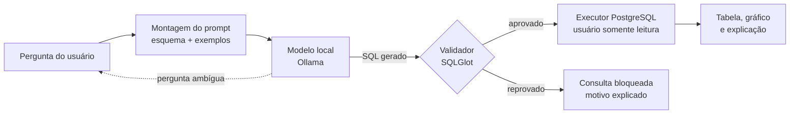

# "Tema 9", Assistente de dados com text-to-SQL seguro

Assistente que responde perguntas em português sobre despesas públicas federais. Ele gera SQL com um modelo aberto local, **valida a consulta antes de executar**, mostra tabela e gráfico e explica a consulta em linguagem simples.

Projeto da disciplina Projetos de IA na Programação.

## Problema

Os dados de despesas federais são abertos, mas consultá-los exige saber SQL ou navegar por filtros técnicos. Um modelo de linguagem traduz perguntas em SQL, porém pode gerar consultas erradas, destrutivas ou caras. Este projeto mede quanto o esquema no prompt e uma etapa de validação melhoram a acurácia e a segurança.

## Arquitetura



- **Dados:** CSV de Orçamento da Despesa (anual) e Execução da Despesa (12 arquivos mensais) do Portal da Transparência, ano 2025, carregados no PostgreSQL pelo serviço `carga`. Sem dados de pessoas físicas: o nome do autor de emenda parlamentar é descartado e vira só a coluna `com_emenda`.
- **Esquema consultável:** `orgao`, `funcao`, `subfuncao`, `programa_acao`, `orcamento` e `execucao_mensal`, com comentários em tabelas e colunas que alimentam o prompt do modelo. Definido em [`esquema.py`](src/assistente_sql/esquema.py).
- **Modelo:** modelo aberto de código rodando no Ollama. Custo zero, sem chaves de API.
- **Validador:** aceita um único `SELECT`; bloqueia escrita, comandos administrativos, leitura de arquivos e tabelas fora da lista; aplica `LIMIT`.
- **Defesa em camadas:** mesmo que o validador falhe, a aplicação consulta com o usuário `leitor`, que só tem `SELECT` no schema `public`, transações somente leitura e limite de 15 s por consulta ([`01-leitor.sh`](docker/postgres/01-leitor.sh)).

## Como rodar

### Testes (disponível desde o Marco 1)

```bash
python -m venv .venv
source .venv/bin/activate        # Windows: .venv\Scripts\activate
pip install -e ".[dev]"
pytest -v
ruff check . && ruff format --check .
```

### Banco de dados com as despesas de 2025 (Marco 2)

O banco é um PostgreSQL 16 em container. Um segundo container (`carga`) baixa os CSV do Portal da Transparência e popula o banco. Só é preciso ter Docker e Git; Python não é necessário para subir o banco (a carga roda dentro do container).

#### 1. Instalar as dependências

Requisitos de máquina: 4 GB de RAM livres, cerca de 3 GB de disco (imagens, ZIPs e banco) e acesso à internet.

**Windows 10/11 (máquina local)**

O Docker Desktop roda os containers numa VM Linux leve do WSL2, então o WSL vem primeiro.

1. No PowerShell **como administrador**: `wsl --install` e reinicie o computador.
2. Instale o [Docker Desktop](https://docs.docker.com/desktop/setup/install/windows-install/) com a opção "Use WSL 2" marcada (padrão).
3. Instale o [Git for Windows](https://git-scm.com/download/win).
4. Abra o Docker Desktop e espere o status "Engine running". Depois, num terminal **novo** (para pegar o PATH atualizado):

   ```powershell
   docker version            # precisa mostrar as seções Client e Server
   docker compose version
   ```

   Se aparecer `failed to connect to the docker API`, o Docker Desktop não está aberto.

**VM Linux (Ubuntu 22.04 ou 24.04)**

Instalação do Docker Engine pelo repositório oficial ([documentação](https://docs.docker.com/engine/install/ubuntu/)):

```bash
sudo apt-get update
sudo apt-get install -y ca-certificates curl git
sudo install -m 0755 -d /etc/apt/keyrings
sudo curl -fsSL https://download.docker.com/linux/ubuntu/gpg -o /etc/apt/keyrings/docker.asc
sudo chmod a+r /etc/apt/keyrings/docker.asc
echo "deb [arch=$(dpkg --print-architecture) signed-by=/etc/apt/keyrings/docker.asc] \
  https://download.docker.com/linux/ubuntu $(. /etc/os-release && echo "${UBUNTU_CODENAME:-$VERSION_CODENAME}") stable" \
  | sudo tee /etc/apt/sources.list.d/docker.list > /dev/null
sudo apt-get update
sudo apt-get install -y docker-ce docker-ce-cli containerd.io docker-buildx-plugin docker-compose-plugin

# Permite usar docker sem sudo (saia e entre de novo na sessão depois)
sudo usermod -aG docker $USER
```

Confira com `docker version` e `docker compose version`.

#### 2. Configurar e subir o banco

```bash
git clone <url-do-repositorio> text-to-sql-seguro
cd text-to-sql-seguro
cp .env.example .env              # edite e troque POSTGRES_PASSWORD e POSTGRES_LEITOR_SENHA
mkdir -p data/raw                 # Windows (PowerShell): mkdir data\raw
docker compose up -d --wait db    # sobe o PostgreSQL e espera ficar saudável
docker compose run --rm carga     # baixa ~90 MB do Portal da Transparência e carrega
```

Para gerar senhas: `openssl rand -hex 16` (Linux) ou qualquer gerador de senhas. O `.env` está no `.gitignore` e nunca vai para o Git.

A carga leva cerca de 1 a 2 minutos depois do download e termina com a contagem de linhas:

```text
orgao                   268 linhas
funcao                   29 linhas
subfuncao               102 linhas
programa_acao          2437 linhas
orcamento             26160 linhas
execucao_mensal      791013 linhas
```

A carga guarda os ZIPs em `data/raw/` (fora do Git) e não baixa de novo o que já existe. Ela roda numa única transação e recria as tabelas, então pode ser repetida a qualquer momento. Para só baixar, sem banco: `python -m assistente_sql.carga --so-baixar`.

#### 3. Conferir

```bash
docker compose ps                                              # db com status "healthy"
docker compose exec db psql -U carga -d despesas -c "\dt+"     # as 6 tabelas
docker compose exec db psql -U carga -d despesas \
  -c "SELECT f.nome, round(sum(e.valor_pago)/1e9, 1) AS pago_bi FROM execucao_mensal e
      JOIN funcao f ON f.codigo = e.codigo_funcao GROUP BY 1 ORDER BY 2 DESC LIMIT 5"
```

O banco escuta só em `127.0.0.1:5432`. Para acessar de um cliente gráfico (DBeaver, pgAdmin) na própria máquina, use o usuário `leitor` e a senha `POSTGRES_LEITOR_SENHA` do `.env`. Numa VM remota, use um túnel SSH (`ssh -L 5432:localhost:5432 usuario@vm`) em vez de abrir a porta para a rede.

#### Problemas comuns

| Sintoma | Causa e solução |
| --- | --- |
| `failed to connect to the docker API` | Docker Desktop fechado (Windows) ou serviço parado (Linux: `sudo systemctl start docker`). |
| `permission denied ... docker.sock` | Usuário fora do grupo `docker`: rode o `usermod` acima e entre de novo na sessão. |
| `port is already allocated` na porta 5432 | Já existe um PostgreSQL na máquina. Mude `POSTGRES_PORTA` no `.env` (por exemplo, 5433). |
| `defina POSTGRES_PASSWORD no .env` | Faltou criar o `.env` a partir do `.env.example`. |
| `Permission denied: '/dados/...'` na carga (Linux) | `data/raw` foi criado pelo Docker como root. Rode `sudo chown -R 1000:1000 data/raw`. |
| Trocou a senha no `.env` e o banco recusa | As senhas só são lidas na criação do volume. Para recriar do zero: `docker compose down -v` e suba de novo (apaga o banco; os ZIPs em `data/raw` ficam). |

### Aplicação completa (a partir do Marco 2)

```bash
cp .env.example .env
docker compose up
```

Variáveis de ambiente: veja `.env.example`. Nenhuma chave de API é necessária.

## Estrutura

```text
src/assistente_sql/   código da aplicação (validador já implementado)
tests/                testes automatizados
eval/                 perguntas de referência, catálogo de ataques e scripts de avaliação
evidencias/           vídeo, logs, prints e índice das evidências
docs/                 documentação técnica e trabalho de pesquisa em PDF
docker/postgres/      script de inicialização do banco (usuário somente leitura)
data/raw/             ZIPs baixados do Portal da Transparência (fora do Git)
```

## Andamento

- [x] Marco 1 · proposta técnica, repositório e CI rodando testes
- [ ] Marco 2 · carga dos dados, fluxo ponta a ponta no Streamlit, Docker Compose
- [ ] Marco 3 · MVP completo, 50 perguntas de referência, catálogo de ataques, baselines
- [ ] Marco 4 · avaliação concluída, documentação técnica e evidências

## Integrantes e contribuição

| Integrante | Papel | Contribuição principal |
| --- | --- | --- |
| _(nome)_ | Dados e Qualidade | |
| _(Rogério Rocha)_ | Backend e Infraestrutura | Marco 1: Proposta técnica, repositório, integração e revisão contínua|
| _(nome)_ | IA e Avaliação | |
| _(nome)_ | Produto e Interface | |

## Uso de IA

Ferramentas usadas na programação e o registro das interações estão em [`PROMPTS.md`](PROMPTS.md).

## Licenças

Código sob licença MIT (veja `LICENSE`). Dependências principais: SQLGlot (MIT), PostgreSQL (PostgreSQL License), psycopg (LGPL 3.0), Streamlit (Apache 2.0), Ollama (MIT). Dados: Portal da Transparência do Governo Federal (CGU), dados abertos.
