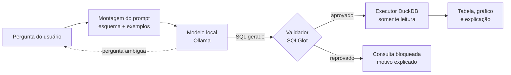

# "Tema 9", Assistente de dados com text-to-SQL seguro

Assistente que responde perguntas em português sobre despesas públicas federais. Ele gera SQL com um modelo aberto local, **valida a consulta antes de executar**, mostra tabela e gráfico e explica a consulta em linguagem simples.

Projeto da disciplina Projetos de IA na Programação.

## Problema

Os dados de despesas federais são abertos, mas consultá-los exige saber SQL ou navegar por filtros técnicos. Um modelo de linguagem traduz perguntas em SQL, porém pode gerar consultas erradas, destrutivas ou caras. Este projeto mede quanto o esquema no prompt e uma etapa de validação melhoram a acurácia e a segurança.

## Arquitetura



- **Dados:** foto fixa dos CSV de Orçamento e Execução da Despesa do Portal da Transparência (2025), carregada no DuckDB. Sem dados de pessoas físicas.
- **Modelo:** modelo aberto de código rodando no Ollama. Custo zero, sem chaves de API.
- **Validador:** aceita um único `SELECT`; bloqueia escrita, comandos administrativos do DuckDB, leitura de arquivos e tabelas fora da lista; aplica `LIMIT`.
- **Defesa em camadas:** mesmo que o validador falhe, o banco é aberto em modo somente leitura.

## Como rodar

### Testes (disponível desde o Marco 1)

```bash
python -m venv .venv
source .venv/bin/activate        # Windows: .venv\Scripts\activate
pip install -e ".[dev]"
pytest -v
ruff check . && ruff format --check .
```

### Aplicação completa (a partir do Marco 2)

```bash
cp .env.example .env
docker compose up
```

Variáveis de ambiente: veja `.env.example`. Nenhuma chave é necessária.

## Estrutura

```text
src/assistente_sql/   código da aplicação (validador já implementado)
tests/                testes automatizados
eval/                 perguntas de referência, catálogo de ataques e scripts de avaliação
evidencias/           vídeo, logs, prints e índice das evidências
docs/                 documentação técnica e trabalho de pesquisa em PDF
data/                 banco DuckDB gerado pelo script de carga (fora do Git)
```

## Andamento

- [x] Marco 1 · proposta técnica, repositório e CI rodando testes
- [ ] Marco 2 · carga dos dados, fluxo ponta a ponta no Streamlit, Docker Compose
- [ ] Marco 3 · MVP completo, 50 perguntas de referência, catálogo de ataques, baselines
- [ ] Marco 4 · avaliação concluída, documentação técnica e evidências

## Integrantes e contribuição

| Integrante | Papel | Contribuição principal |
| --- | --- | --- |
| _(nome)_ | Dados e Qualidade | |
| _(Rogério Rocha)_ | Backend e Infraestrutura | Marco 1: Proposta técnica, repositório e integração e revisão contínua|
| _(nome)_ | IA e Avaliação | |
| _(nome)_ | Produto e Interface | |

## Uso de IA

Ferramentas usadas na programação e o registro das interações estão em [`PROMPTS.md`](PROMPTS.md).

## Licenças

Código sob licença MIT (veja `LICENSE`). Dependências principais: SQLGlot (MIT), DuckDB (MIT), Streamlit (Apache 2.0), Ollama (MIT). Dados: Portal da Transparência do Governo Federal (CGU), dados abertos.
