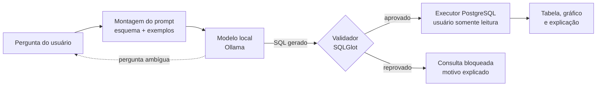

# "Tema 9", Assistente de dados com text-to-SQL seguro

Assistente que responde perguntas em português sobre despesas públicas federais. Ele gera SQL com um modelo aberto local, **valida a consulta antes de executar**, mostra tabela e gráfico e explica a consulta em linguagem simples.

Projeto da disciplina Projetos de IA na Programação.

## Problema

Os dados de despesas federais são abertos, mas consultá-los exige saber SQL ou navegar por filtros técnicos. Um modelo de linguagem traduz perguntas em SQL, porém pode gerar consultas erradas, destrutivas ou caras. Este projeto mede quanto o esquema no prompt e uma etapa de validação melhoram a acurácia e a segurança.

## Arquitetura



- **Dados:** CSV de Orçamento da Despesa (anual) e Execução da Despesa (12 arquivos mensais) do Portal da Transparência, ano 2025, carregados no PostgreSQL pelo serviço `carga`. Sem dados de pessoas físicas: o nome do autor de emenda parlamentar é descartado e vira só a coluna `com_emenda`.
- **Esquema consultável:** `orgao`, `funcao`, `subfuncao`, `programa_acao`, `orcamento` e `execucao_mensal`, com comentários em tabelas e colunas que alimentam o prompt do modelo. Definido em [`esquema.py`](src/assistente_sql/esquema.py).
- **Modelo:** modelo aberto de código rodando no Ollama. Custo zero, sem chaves de API.
- **Validador:** aceita um único `SELECT` no dialeto do PostgreSQL; bloqueia escrita (inclusive escondida em `WITH`, `SELECT INTO` e `FOR UPDATE`), comandos administrativos, funções perigosas (`pg_sleep`, `pg_read_file`, `set_config`, `query_to_xml`, `dblink`...), schemas fora de `public` e tabelas fora da lista; aplica `LIMIT`; e recusa consultas com custo estimado pelo `EXPLAIN` acima de 1.000.000 ([calibração](eval/README.md)).
- **Defesa em camadas:** mesmo que o validador falhe, a aplicação consulta com o usuário `leitor`, que só tem `SELECT` no schema `public`, transações somente leitura e limite de 15 s por consulta ([`01-leitor.sh`](docker/postgres/01-leitor.sh)).

## Como rodar

### Testes (disponível desde o Marco 1)

Os testes de custo que usam o banco real são pulados, a menos que `DATABASE_URL_LEITOR` esteja definida (por exemplo, `postgresql://leitor:<senha>@127.0.0.1:5432/despesas`, com o banco do Marco 2 no ar).

```bash
python -m venv .venv
source .venv/bin/activate        # Windows: .venv\Scripts\activate
pip install -e ".[dev]"
pytest -v
ruff check . && ruff format --check .
```

### Instalação e execução com Docker (Marco 2)

O projeto inteiro roda em containers: o banco PostgreSQL, a carga dos dados do Portal da Transparência, o modelo de IA (Ollama) e a interface de chat (Streamlit). Um único `docker compose up` sobe tudo.

#### 1. Instalar as dependências

**O que precisa instalar**

| Programa | Obrigatório? | Para quê |
| --- | --- | --- |
| Docker (Docker Desktop no Windows, Docker Engine no Linux) | Sim | Rodar todos os serviços |
| Git | Sim | Baixar o repositório |
| Driver NVIDIA atualizado | Não | Rodar o modelo na GPU, bem mais rápido (veja o passo 2) |
| Python 3.11 ou mais novo | Não | Só para desenvolver: rodar os testes e as perguntas pela linha de comando |

**O que não precisa instalar:** PostgreSQL, Ollama, Streamlit e as bibliotecas Python da aplicação já vêm nos containers. Se o Ollama já estiver instalado direto no computador, feche-o antes de subir o projeto, porque os dois disputam a porta 11434.

**Requisitos da máquina**

- **Disco:** cerca de 16 GB livres (imagem do Ollama com CUDA, 8,5 GB; modelo `qwen2.5-coder:7b`, 4,7 GB; banco, dados e imagem da aplicação, cerca de 2 GB).
- **Memória:** 8 GB de RAM livres para o Docker com o modelo 7B. Com menos, use `OLLAMA_MODELO=qwen2.5-coder:3b` no `.env` (1,9 GB). No Windows, o Docker Desktop usa por padrão até metade da RAM do computador.
- **Internet:** só na primeira execução, para baixar imagens, dados e modelo.

**Windows 10/11 (máquina local)**

O Docker Desktop roda os containers numa VM Linux leve do WSL2, então o WSL vem primeiro.

1. No PowerShell **como administrador**: `wsl --install` e reinicie o computador.
2. Instale o [Docker Desktop](https://docs.docker.com/desktop/setup/install/windows-install/) com a opção "Use WSL 2" marcada (padrão).
3. Instale o [Git for Windows](https://git-scm.com/download/win).
4. Abra o Docker Desktop e espere o status "Engine running". Depois, num terminal **novo** (para pegar o PATH atualizado):

   ```powershell
   docker version            # precisa mostrar as seções Client e Server
   docker compose version
   ```

   Se aparecer `failed to connect to the docker API`, o Docker Desktop não está aberto.

**VM Linux (Ubuntu 22.04 ou 24.04)**

Instalação do Docker Engine pelo repositório oficial ([documentação](https://docs.docker.com/engine/install/ubuntu/)):

```bash
sudo apt-get update
sudo apt-get install -y ca-certificates curl git
sudo install -m 0755 -d /etc/apt/keyrings
sudo curl -fsSL https://download.docker.com/linux/ubuntu/gpg -o /etc/apt/keyrings/docker.asc
sudo chmod a+r /etc/apt/keyrings/docker.asc
echo "deb [arch=$(dpkg --print-architecture) signed-by=/etc/apt/keyrings/docker.asc] \
  https://download.docker.com/linux/ubuntu $(. /etc/os-release && echo "${UBUNTU_CODENAME:-$VERSION_CODENAME}") stable" \
  | sudo tee /etc/apt/sources.list.d/docker.list > /dev/null
sudo apt-get update
sudo apt-get install -y docker-ce docker-ce-cli containerd.io docker-buildx-plugin docker-compose-plugin

# Permite usar docker sem sudo (saia e entre de novo na sessão depois)
sudo usermod -aG docker $USER
```

Confira com `docker version` e `docker compose version`.

**GPU NVIDIA (opcional)**

- **Windows:** basta o driver NVIDIA atualizado; o Docker Desktop repassa a GPU pelo WSL2.
- **Linux:** além do driver, instale o [NVIDIA Container Toolkit](https://docs.nvidia.com/datacenter/cloud-native/container-toolkit/latest/install-guide.html).

Para conferir se o Docker enxerga a placa: `docker run --rm --gpus all --entrypoint nvidia-smi ollama/ollama:0.40.13 -L` (deve listar a GPU). Depois, ative a GPU no `.env` (passo 2).

#### 2. Configurar e subir

```bash
git clone <url-do-repositorio> text-to-sql-seguro
cd text-to-sql-seguro
cp .env.example .env              # edite e troque POSTGRES_PASSWORD e POSTGRES_LEITOR_SENHA
mkdir -p data/raw                 # Windows (PowerShell): mkdir data\raw
docker compose up -d              # sobe tudo em segundo plano
docker compose logs -f carga ollama-modelo   # acompanha a primeira carga e o download do modelo (Ctrl+C para sair)
```

Para gerar senhas: `openssl rand -hex 16` (Linux) ou qualquer gerador de senhas. O `.env` está no `.gitignore` e nunca vai para o Git.

Para usar a GPU, descomente no `.env`, **antes** do `docker compose up`, a linha `COMPOSE_FILE` do seu sistema (`;` no Windows, `:` no Linux e no macOS).

O `docker compose up` faz, na ordem:

1. Sobe o PostgreSQL e o Ollama.
2. **Carga:** baixa cerca de 90 MB do Portal da Transparência e carrega o banco. Só roda se o banco estiver vazio.
3. **Modelo:** baixa o `OLLAMA_MODELO`. Só roda se o modelo ainda não estiver no volume.
4. Inicia a interface de chat.

Na primeira vez, isso leva de 10 a 30 minutos, dependendo da internet. Nas seguintes, sobe em segundos e sem internet.

Para subir passo a passo, em vez de tudo de uma vez:

```bash
docker compose up -d --wait db           # só o PostgreSQL
docker compose run --rm carga            # carrega os dados
docker compose up -d --wait ollama       # servidor do modelo
docker compose run --rm ollama-modelo    # baixa o modelo
docker compose up -d app                 # interface
```

A carga leva cerca de 1 a 2 minutos depois do download e termina com a contagem de linhas:

```text
orgao                   268 linhas
funcao                   29 linhas
subfuncao               102 linhas
programa_acao          2437 linhas
orcamento             26160 linhas
execucao_mensal      791013 linhas
```

A carga guarda os ZIPs em `data/raw/` (fora do Git) e não baixa de novo o que já existe. Ela roda numa única transação e recria as tabelas. Para forçar uma recarga: `docker compose run --rm carga python -m assistente_sql.carga`. Para só baixar, sem banco: `python -m assistente_sql.carga --so-baixar`.

#### 3. Abrir o chat

Com tudo no ar, abra **http://localhost:8501** no navegador. Para usar outra porta, defina `APP_PORTA` no `.env`.

Digite a pergunta em português e clique em **Perguntar**. Exemplos:

- "Quais os 5 estados que mais receberam pagamentos em 2025?"
- "Qual foi o valor pago por mês na função Saúde?"
- "Qual o orçamento atualizado e o realizado do Ministério da Educação?"

Para cada pergunta, a tela mostra:

- se a consulta foi executada ou **bloqueada** pela validação, e o motivo;
- o SQL gerado;
- a tabela de resultado;
- um gráfico, quando o resultado tem uma categoria e um valor;
- em **Detalhes**, o tempo de cada etapa e o custo estimado.

A primeira pergunta demora mais, porque o modelo é carregado na memória: cerca de 50 s numa RTX 3050 de 6 GB, e mais tempo na CPU (não medido ainda). As seguintes levam de 5 a 7 s nessa GPU.

Todos os endereços escutam só em `127.0.0.1`:

| Serviço | Endereço |
| --- | --- |
| Chat (Streamlit) | http://localhost:8501 |
| Banco (PostgreSQL) | `127.0.0.1:5432` |
| Modelo (API do Ollama) | http://localhost:11434 |

Numa VM remota, use túnel SSH em vez de abrir portas para a rede: `ssh -L 8501:localhost:8501 usuario@vm` e abra http://localhost:8501 no seu computador.

Para parar: `docker compose stop`. Para apagar tudo, inclusive banco e modelo: `docker compose down -v`.

#### 4. Conferir

```bash
docker compose ps -a                                           # db, ollama e app "Up"; carga e ollama-modelo "Exited (0)"
curl http://localhost:8501/_stcore/health                      # responde "ok"
docker compose exec db psql -U carga -d despesas -c "\dt+"     # as 6 tabelas
docker compose exec db psql -U carga -d despesas \
  -c "SELECT f.nome, round(sum(e.valor_pago)/1e9, 1) AS pago_bi FROM execucao_mensal e
      JOIN funcao f ON f.codigo = e.codigo_funcao GROUP BY 1 ORDER BY 2 DESC LIMIT 5"
```

O banco escuta só em `127.0.0.1:5432`. Para acessar de um cliente gráfico (DBeaver, pgAdmin) na própria máquina, use o usuário `leitor` e a senha `POSTGRES_LEITOR_SENHA` do `.env`. Numa VM remota, use um túnel SSH (`ssh -L 5432:localhost:5432 usuario@vm`) em vez de abrir a porta para a rede.

#### Problemas comuns

| Sintoma | Causa e solução |
| --- | --- |
| `failed to connect to the docker API` | Docker Desktop fechado (Windows) ou serviço parado (Linux: `sudo systemctl start docker`). |
| `permission denied ... docker.sock` | Usuário fora do grupo `docker`: rode o `usermod` acima e entre de novo na sessão. |
| `port is already allocated` na porta 5432 | Já existe um PostgreSQL na máquina. Mude `POSTGRES_PORTA` no `.env` (por exemplo, 5433). |
| `defina POSTGRES_PASSWORD no .env` | Faltou criar o `.env` a partir do `.env.example`. |
| `Permission denied: '/dados/...'` na carga (Linux) | `data/raw` foi criado pelo Docker como root. Rode `sudo chown -R 1000:1000 data/raw`. |
| Trocou a senha no `.env` e o banco recusa | As senhas só são lidas na criação do volume. Para recriar do zero: `docker compose down -v` e suba de novo (apaga o banco; os ZIPs em `data/raw` ficam). |
| `port is already allocated` na 11434 | O Ollama instalado direto no computador está aberto. Feche-o ou mude `OLLAMA_PORTA` no `.env`. |
| `port is already allocated` na 8501 | Outro Streamlit está rodando. Feche-o ou mude `APP_PORTA` no `.env`. |
| http://localhost:8501 não abre | A primeira subida ainda está baixando dados ou o modelo: acompanhe com `docker compose logs -f carga ollama-modelo`. O `app` só inicia depois que os dois terminam. |
| "O modelo não respondeu" no chat | Modelo sem memória suficiente: veja `docker compose logs ollama`. Troque para `OLLAMA_MODELO=qwen2.5-coder:3b` ou aumente a memória do Docker Desktop (Settings > Resources). |
| `could not select device driver "nvidia"` | A GPU foi ativada no `.env`, mas o Docker não enxerga a placa. Instale o driver (e, no Linux, o NVIDIA Container Toolkit) ou comente a linha `COMPOSE_FILE`. |
| Sem espaço em disco durante o download | São necessários cerca de 16 GB. Libere espaço ou use o modelo 3B. |

### Perguntas pela linha de comando (desenvolvimento)

Com o banco e o Ollama no ar, dá para perguntar sem a interface, fora do Docker, com o ambiente dos testes:

```bash
export DATABASE_URL_LEITOR=postgresql://leitor:<senha>@127.0.0.1:5432/despesas   # PowerShell: $env:DATABASE_URL_LEITOR="..."
python -m assistente_sql.assistente "Quanto o Ministério da Saúde pagou em 2025?"
```

A saída mostra o SQL gerado, a situação (`ok`, `bloqueada`, `erro_execucao` ou `erro_modelo`), o motivo do bloqueio e o tempo de cada etapa.

Variáveis de ambiente: veja `.env.example`. Nenhuma chave de API é necessária.

## Estrutura

```text
src/assistente_sql/   código da aplicação: carga, validador, gerador (Ollama), fluxo ponta a ponta e interface (app.py)
tests/                testes automatizados
eval/                 perguntas de referência, catálogo de ataques e scripts de avaliação
evidencias/           vídeo, logs, prints e índice das evidências
docs/                 documentação técnica e trabalho de pesquisa em PDF
docker/postgres/      script de inicialização do banco (usuário somente leitura)
data/raw/             ZIPs baixados do Portal da Transparência (fora do Git)
```

## Andamento

- [x] Marco 1 · proposta técnica, repositório e CI rodando testes
- [x] Marco 2 · carga dos dados, fluxo ponta a ponta no Streamlit, Docker Compose
- [ ] Marco 3 · MVP completo, 50 perguntas de referência, catálogo de ataques, baselines
- [ ] Marco 4 · avaliação concluída, documentação técnica e evidências

## Integrantes e contribuição

| Integrante | Papel | Contribuição principal |
| --- | --- | --- |
| _(Rodrigo e Thallia)_ | Dados e Qualidade | Marco 2: Thallia Silva de Oliveira: download e análise dos dados de 2025 do Portal da Transparência, conferência da carga no banco local, documentação da decisão sobre órgãos sem código (`docs/decisoes-de-dados.md`) e registro de uso de IA (`PROMPTS.md`). Rodrigo: estrutura docker, git Windows e preparo do Marco 2 |
| _(Rogério Rocha)_ | Backend e Infraestrutura | Marco 1: Proposta técnica, repositório, integração e revisão contínua|
| _(nome)_ | IA e Avaliação | |
| _(nome)_ | Produto e Interface | |

**Contas no GitHub:** Rodrigo Santos faz commits como `rodrigo-santos-2411288` (`2411288@escolas.anchieta.br`). O commit `b3fac88` (carga dos dados do Marco 2) saiu pela conta pessoal `RodrigoRibeiroSantos`, que também é dele.

## Uso de IA

Ferramentas usadas na programação e o registro das interações estão em [`PROMPTS.md`](PROMPTS.md).

## Licenças

Código sob licença MIT (veja `LICENSE`). Dependências principais: SQLGlot (MIT), PostgreSQL (PostgreSQL License), psycopg (LGPL 3.0), Streamlit (Apache 2.0), Ollama (MIT). Dados: Portal da Transparência do Governo Federal (CGU), dados abertos.
