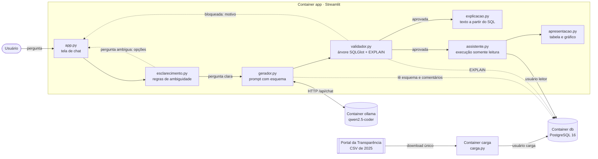
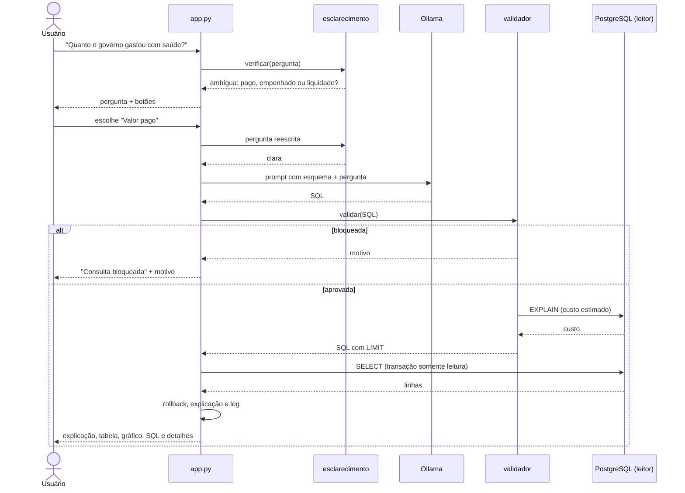

# Visão geral e arquitetura

O assistente recebe uma pergunta em português sobre despesas públicas federais de 2025, gera uma consulta SQL com um modelo aberto local, confere a consulta antes de executar e devolve tabela, gráfico e uma explicação em linguagem simples. Tudo roda em containers na máquina do usuário, sem serviço pago.

## Componentes

A mesma imagem em SVG, usada no README e na proposta técnica, está em [`arquitetura.svg`](arquitetura.svg).

| Componente | Arquivo | Responsabilidade |
| --- | --- | --- |
| Interface | [`app.py`](../src/assistente_sql/app.py) | Campo de pergunta, botões de esclarecimento, resultado, gráfico, SQL e detalhes; ao abrir, aquece o modelo em segundo plano (carrega o modelo e lê o esquema) |
| Esclarecimento | [`esclarecimento.py`](../src/assistente_sql/esclarecimento.py) | Três regras que rodam antes do modelo: medida de gasto, tipo de orçamento e ano fora de 2025 ([DA-05](decisoes-de-arquitetura.md)) |
| Gerador | [`gerador.py`](../src/assistente_sql/gerador.py) | Lê o esquema do banco, monta o prompt e chama o Ollama com temperatura 0, contexto de 4.096 e no máximo 512 tokens; repete uma vez quando o modelo entra em laço ([DA-03](decisoes-de-arquitetura.md)) |
| Validador | [`validador.py`](../src/assistente_sql/validador.py) | Aceita um único `SELECT` permitido, aplica `LIMIT` e recusa custo estimado acima do limite ([DA-02](decisoes-de-arquitetura.md)) |
| Explicação | [`explicacao.py`](../src/assistente_sql/explicacao.py) | Descreve em português o SQL que vai ao banco, sem chamar o modelo ([DA-04](decisoes-de-arquitetura.md)) |
| Fluxo | [`assistente.py`](../src/assistente_sql/assistente.py) | Encadeia as etapas, executa numa transação somente leitura sempre desfeita e grava o log |
| Apresentação | [`apresentacao.py`](../src/assistente_sql/apresentacao.py) | Formata a tabela e escolhe o gráfico (linha para meses, barras para categorias) |
| Carga | [`carga.py`](../src/assistente_sql/carga.py), [`fontes.py`](../src/assistente_sql/fontes.py), [`esquema.py`](../src/assistente_sql/esquema.py) | Baixa os 13 arquivos do Portal, confere os cabeçalhos e carrega as 6 tabelas numa transação |
| Banco | [`01-leitor.sh`](../docker/postgres/01-leitor.sh) | Cria o usuário `leitor`: só `SELECT` no schema `public`, transação somente leitura e 15 s por consulta ([DA-01](decisoes-de-arquitetura.md)) |

## Fluxo de uma pergunta

Cada pergunta termina em uma de cinco situações, gravadas no campo `situacao` da resposta e no log:

| Situação | Onde parou | O que a tela mostra |
| --- | --- | --- |
| `esclarecimento` | Antes do modelo | A pergunta de esclarecimento e os botões com as opções |
| `erro_modelo` | Chamada ao Ollama (rede, tempo, modelo não baixado) | "O modelo não respondeu" e a mensagem de erro |
| `bloqueada` | Validador ou limite de custo | "Consulta bloqueada pela validação" e o motivo |
| `erro_execucao` | Banco (tempo limite, coluna inexistente) | "O banco recusou a consulta" e a mensagem do banco |
| `ok` | Executada | Explicação, tabela, gráfico (quando há categoria e valor), SQL e detalhes |

## Fluxo dos dados

1. **Origem:** arquivos CSV do Portal da Transparência (CGU), Orçamento da Despesa de 2025 e Execução da Despesa de janeiro a dezembro de 2025.
2. **Carga** (`docker compose run --rm carga`): baixa os ZIPs para `data/raw/`, confere o cabeçalho de cada CSV, descarta o nome do autor de emenda (vira `com_emenda`), normaliza órgãos sem código ([decisoes-de-dados.md](decisoes-de-dados.md)) e grava as 6 tabelas numa única transação, como usuário `carga`.
3. **Consulta:** a aplicação só conecta como `leitor`. O esquema que vai no prompt é lido do próprio banco (tabelas, colunas, comentários, chaves e valores comuns).
4. **Saída:** a tela mostra o resultado; o log do container `app` registra pergunta, situação, regra de esclarecimento, número de linhas, custo, tempos, SQL e motivo. Não há gravação de histórico em banco nem em arquivo da aplicação.

Detalhes sobre os dados e o modelo estão em [dados-e-modelo.md](dados-e-modelo.md).
