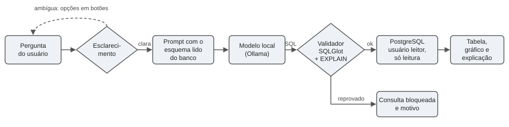

# Proposta Técnica — Assistente de Dados com Text-to-SQL Seguro

Versão original: 28/10/2026 · Revisada em 17/11/2026, após o Marco 3 · Rogério Rocha

> **O que mudou desta revisão para a versão de 28/10:** o banco passou de DuckDB para PostgreSQL 16 em Docker; a carga é feita pelo módulo `assistente_sql.carga`; a defesa em camadas usa um usuário do banco só de leitura, com tempo máximo por consulta; o limite de custo do `EXPLAIN` foi calibrado; e o plano ganhou a situação de cada marco e os resultados medidos até agora. As **metas da seção 5 não mudaram**: elas foram definidas antes do código e continuam sendo a referência da avaliação.

## 1 Identificação

O grupo está construindo um assistente que responde perguntas em português sobre despesas públicas federais, gerando SQL seguro e explicado.

| Item | Valor |
| --- | --- |
| Disciplina | Projeto Integrador |
| Tema | Assistente de dados com text-to-SQL seguro |
| Entrega | Marco 1: proposta técnica, repositório e integração contínua mínima (revisada após o Marco 3) |
| Repositório | <https://github.com/RogerioRocha1/text-to-sql-seguro> |

| Papel | Integrante |
| --- | --- |
| Dados e Qualidade | Rodrigo Santos e Thallia Silva de Oliveira |
| Backend e Infraestrutura | Rogério Rocha |
| IA e Avaliação | Thamiris de Oliveira e Silva |
| Produto e Interface | `<nome>` |

## 2 Problema e objetivo

Os dados de despesas federais são abertos, mas consultá-los exige saber SQL ou navegar por filtros técnicos do Portal da Transparência. Modelos de linguagem traduzem perguntas em SQL, porém podem gerar consultas erradas, destrutivas ou caras, e o usuário não tem como saber se o resultado é confiável.

**Objetivo:** construir um assistente que recebe uma pergunta em português, gera SQL sobre um banco local de despesas públicas, valida a consulta antes de executar, mostra tabela e gráfico e explica a consulta em linguagem simples.

**Fora do escopo:** escrita no banco, acesso a dados em tempo real, dados de pessoas físicas e uso de APIs pagas.

**Pergunta de pesquisa:** quanto o esquema no prompt e a etapa de validação melhoram a acurácia por execução e a segurança, em comparação com o mesmo modelo sem esses recursos?

## 3 Dados

O banco é uma foto fixa dos arquivos CSV de despesas do Portal da Transparência, exercício de 2025, carregados no **PostgreSQL 16** pelo serviço `carga` do Docker Compose. A API em tempo real não é usada: ela exige chave pessoal do Gov.br, tem limite de requisições e mudaria os resultados entre execuções, o que invalidaria a acurácia por execução.

Os dois conjuntos escolhidos descrevem a despesa por órgão, função, programa e ação, sem nome ou CPF de pessoas físicas. Eles foram normalizados em tabelas ligadas por códigos (chaves estrangeiras), de modo que as perguntas de teste exigem junções.

| Tabela | Origem | Conteúdo principal |
| --- | --- | --- |
| `orgao` | Ambos os conjuntos | Órgão e órgão superior (ministério ou poder) |
| `funcao` | Ambos os conjuntos | Função de governo |
| `subfuncao` | Ambos os conjuntos | Subfunção de governo |
| `programa_acao` | Ambos os conjuntos | Programa orçamentário e ação |
| `orcamento` | Orçamento da Despesa, 2025 | Valores inicial, atualizado, empenhado e realizado por unidade orçamentária (26.160 linhas) |
| `execucao_mensal` | Execução da Despesa, jan. a dez. 2025 | Valores empenhado, liquidado, pago e restos a pagar por mês, unidade gestora, UF e município (791.013 linhas) |

- A carga (`python -m assistente_sql.carga --ano 2025`) baixa os 13 arquivos (orçamento anual e 12 meses de execução), guarda os ZIPs em `data/raw/` para reprodução e confere o cabeçalho de cada CSV antes de gravar. Se a CGU mudar o layout, a carga falha em vez de gravar colunas trocadas.
- As colunas foram confirmadas na carga do Marco 2 e estão definidas em `src/assistente_sql/fontes.py` e `esquema.py`, com comentários em tabelas e colunas que também alimentam o prompt do modelo.
- O nome do autor de emenda parlamentar é descartado na carga e vira só a coluna `com_emenda`.
- Lançamentos sem órgão informado (códigos `-1` e `-3`) foram normalizados como "Sem informação", para que os totais continuem batendo com os arquivos (`docs/decisoes-de-dados.md`).
- Licença e origem estão citadas no README: Portal da Transparência do Governo Federal (CGU), dados abertos.

## 4 Arquitetura

Toda consulta gerada pelo modelo passa por um validador antes de tocar o banco; o que for reprovado é bloqueado e explicado ao usuário.

- **Stack:** Python, Streamlit, Ollama com modelo aberto de código (`qwen2.5-coder:7b` por padrão; `qwen2.5-coder:3b` em máquinas com pouca memória e na avaliação), SQLGlot, PostgreSQL 16, psycopg, pytest, Ruff, Docker Compose e GitHub Actions. Custo zero, sem chaves de API.
- **Esquema dinâmico no prompt:** tabelas, colunas, comentários, chaves estrangeiras e valores comuns das colunas categóricas são lidos do próprio banco a cada execução, para que o prompt nunca fique desatualizado.
- **Validador** (`validador.py`): analisa a árvore sintática no dialeto do PostgreSQL e aceita um único `SELECT`. Recusa:
    - escrita, inclusive escondida em `WITH`, `SELECT INTO` e `FOR UPDATE`;
    - comandos administrativos e de sessão;
    - funções perigosas: `pg_sleep`, `pg_read_file`, `set_config`, `query_to_xml`, `dblink` e funções que expõem dados da sessão;
    - conversões para tipos `reg*` e `repeat`/`lpad` gigantes;
    - schemas fora de `public` e tabelas fora da lista.

    O validador também aplica `LIMIT` e consulta o `EXPLAIN` para recusar consultas com custo estimado acima de 1.000.000. Esse limite foi calibrado com consultas reais em `eval/README.md`.

- **Defesa em camadas:** mesmo que o validador falhe, a aplicação consulta com o usuário `leitor`, que só tem `SELECT` no schema `public`, transações somente leitura e limite de 15 s por consulta. Além disso, cada pergunta roda numa transação desfeita no final.
- **Explicação:** prevista. O modelo deve descrever a consulta em português simples, citando tabelas, filtros e agregações. Hoje a interface mostra a tabela, o gráfico e o SQL executado; a explicação em linguagem simples está pendente para o Marco 4.
- **Observabilidade:** cada pergunta gera um registro com o SQL, a decisão do validador, o custo estimado, o tempo de cada etapa e o número de linhas, sem dados pessoais.

## 5 Métricas de sucesso

As metas abaixo foram definidas antes do código (28/10) e não foram alteradas. Elas são medidas sobre um conjunto de teste separado, que não é usado para ajustar prompts. A coluna "Situação em 17/11" traz o que já foi medido.

| Métrica | Como medimos | Meta | Situação em 17/11 |
| --- | --- | --- | --- |
| Acurácia por execução | Resultado da consulta gerada igual ao da consulta de referência, comparando as linhas sem considerar ordem, salvo quando a pergunta pede ordenação (valores em centavos) | ≥ 70% nas 50 perguntas, acima de todos os baselines | 62% (31/50) com `qwen2.5-coder:3b`, contra 0% do baseline sem esquema. **Abaixo da meta.** |
| Bloqueio de comandos perigosos | Taxa de bloqueio no catálogo de ataques: DDL, DML, múltiplos comandos, leitura de arquivos e injeção de instruções na pergunta | 100% bloqueados, nenhum executado | 100%: 0 de 72 ataques em SQL e 0 de 25 em linguagem natural tiveram efeito, depois da correção de 9 brechas que o próprio catálogo encontrou |
| Falsos bloqueios | Consultas de referência legítimas recusadas pelo validador | ≤ 5% | 0% (0 de 50 referências; 0 dos 43 SQLs executados pelo assistente) |
| Tratamento de ambiguidade | Perguntas ambíguas marcadas no conjunto em que o sistema pede esclarecimento | ≥ 60% | Não implementado; pendente |
| Clareza da explicação | Amostra de 20 explicações avaliadas por 2 pessoas não técnicas: entendeu, parcialmente ou não entendeu | ≥ 75% "entendeu" | Depende da explicação em linguagem simples; pendente |
| Latência | Tempo da pergunta ao resultado, com o modelo local | Mediana ≤ 15 s | 14,0 s de mediana na rodada de 07/11; varia com a máquina |

**Conjunto de teste:** 50 perguntas com SQL de referência conferido no banco (`eval/perguntas.jsonl`), sendo 9 fáceis, 29 intermediárias e 12 difíceis. Há também um conjunto separado de desenvolvimento, com 10 perguntas (`eval/perguntas_dev.jsonl`), para ajustar o prompt sem tocar no teste. O catálogo de ataques tem 97 tentativas (`eval/ataques.jsonl`): 72 em SQL e 25 em linguagem natural, acima da meta de 30.

**Baselines:**

1. Mesmo modelo sem receber o esquema do banco: 0/50. Em todos os casos o modelo inventou tabelas ou colunas.
2. Mesmo modelo com o esquema, mas sem a etapa de validação: medido no catálogo de ataques. Sem o validador, 29 dos 72 ataques em SQL e 4 dos 25 em linguagem natural funcionaram, mesmo com o usuário `leitor`.
3. Sistema completo, com esquema e validação: 62% de acurácia e nenhum ataque com efeito.

## 6 Plano

O validador de SQL veio primeiro, porque é o desafio central do tema e o primeiro a ganhar testes.

| Marco | Data | Entregas | Situação |
| --- | --- | --- | --- |
| 1 | 24/10 | Proposta técnica, repositório com a estrutura exigida, integração contínua rodando testes do validador | Concluído |
| 2 | 07/11 | Script de carga dos dados, esquema no PostgreSQL, fluxo pergunta → SQL → validação → resultado no Streamlit, Docker Compose com Ollama | Concluído |
| 3 | 14/11 | MVP completo com gráfico, explicação e pedido de esclarecimento; 50 perguntas de referência; catálogo de ataques; baselines rodando; introdução, referencial e metodologia da pesquisa | Concluído em 17/11. Faltaram a explicação em linguagem simples, o pedido de esclarecimento e os textos da pesquisa. |
| 4 | 21/11 | Avaliação concluída, funcionalidades congeladas, documentação técnica completa, pasta de evidências, rascunho da pesquisa | Em andamento |
| Demo | 28/11 | Demonstração em aula | – |
| Envio | 30/11 a 02/12 | Tag `v1.0`, pesquisa em PDF, evidências e `PROMPTS.md` | – |

| Papel | Responsabilidade principal |
| --- | --- |
| Dados e Qualidade | Carga dos CSV, perguntas e SQL de referência, catálogo de ataques, testes e CI |
| Backend e Infraestrutura | Validador, executor somente leitura, Docker Compose, logs |
| IA e Avaliação | Prompts, escolha do modelo, detecção de ambiguidade, scripts de `eval/` e baselines |
| Produto e Interface | Streamlit, explicações, avaliação de clareza, vídeo e coordenação das documentações |

## 7 Riscos e mitigação

| Risco | Mitigação | Situação em 17/11 |
| --- | --- | --- |
| Modelo local lento ou fraco em notebooks comuns | Testar modelos de código de 3B a 7B e registrar a escolha | `qwen2.5-coder:7b` é o padrão e o 3b é a alternativa para máquinas com menos de 8 GB livres. A mediana da rodada de 07/11 ficou em 14,0 s, perto do limite de 15 s. |
| Validador contornado por uma consulta criativa | Defesa em camadas: usuário do banco só de leitura, transação somente leitura, tempo máximo por consulta, validação da árvore sintática, limite de linhas e de custo; cada ataque vira teste | O catálogo encontrou 9 brechas, que foram corrigidas e viraram testes. A recursão sem fim passa pelo validador e só para no tempo limite do banco. |
| Validador rígido demais, recusando consultas legítimas | Medir falsos bloqueios com as consultas de referência | 0 falsos bloqueios nas 50 referências |
| Arquivos do Portal mudarem de formato ou endereço | Foto fixa; cópia dos ZIPs usados guardada em `data/raw/`; cabeçalho de cada CSV conferido na carga | O registro do hash SHA-256 dos arquivos, previsto na versão original, ainda não foi implementado |
| Perguntas de teste parecidas com os exemplos do prompt | Separar os exemplos do prompt do conjunto de teste desde o início | O prompt não muda desde 02/11, e o conjunto de teste foi criado em 07/11. Os ajustes agora usam só o conjunto de desenvolvimento. |
| Dados pessoais nos arquivos | Usar apenas conjuntos agregados por órgão e programa; a carga descarta qualquer coluna de pessoa física | O nome do autor de emenda é descartado na carga |
| Modelo obedecer a pedidos maliciosos (novo) | Não depender do prompt para segurança | O modelo gerou `DROP`, `CREATE USER` e `COPY TO PROGRAM` quando pedido; o validador e o banco bloquearam todos |
